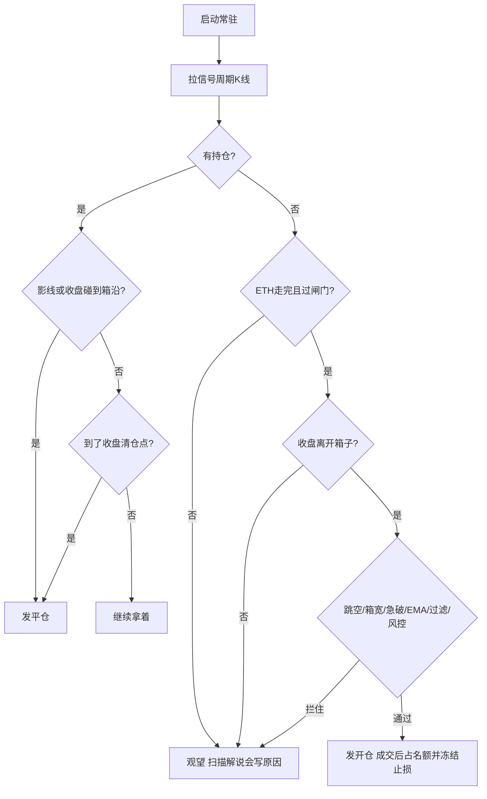

# 日内实体：完整操作说明书

对应程序版本 **22.0.1**。给人看的操作说明。

适用：配置页策略引擎选 **日内实体**（`daily_body`），再点「启动常驻」。  
一次只盯 **一个合约**。程序 **不会** 因为今天震荡就自动换成别的策略。

更细的每个旋钮编号见 [配置说明书.md](配置说明书.md)。  
怎么进化、谁能改实盘见 [策略迭代进化说明.md](策略迭代进化说明.md)。

---

## 一、用一句话说清它在干什么

开盘后先看一段时间（ETH），用这段里已经走完的信号 K 线画出一个箱子。  
**收盘站上箱子最高价才做多，收盘跌破箱子最低价才做空。**  
影线刺出去又收回来，不算。箱子没画完，不开。  
止损钉在箱子的对沿（多守箱底、空守箱顶），开仓后不再收紧。没打掉就拿到收盘清仓。

日盘、夜盘各画各的箱子。13:30 不重新画。日线、周线没有「开盘后几分钟」，这套不用。

日盘有两个 ETH 窗口，**都从这段开盘起算**，两口箱子分开判断。过了第二ETH窗口的时间，就丢掉第一窗口的判断，只认第二口箱子。第一窗口开仓被箱沿止损打掉后，截止前还可以按第二窗口再开一次。夜盘只用第一窗口，只开一次。

配置页「交易时段」选 **夜日连续（跳空小）** 时，夜盘和日盘合成一段：三个 ETH 窗口（21:00+夜盘ETH、9:00+ETH1、9:00+ETH2）各自画箱子，整段最多开三次。夜盘开仓如果没有打止损，不在夜盘收盘清仓，拿到日盘 14:55。中途止损后，按当时对应窗口重新判断。周五夜盘和周一白天算同一个期货交易日。**只给隔夜跳空不大的品种用。** 燃油这类常大幅跳空的，隔夜缺口会把最大回撤拉得很大，请继续用「全时段」，让夜盘自己在 22:55 清仓。

它适合：**开盘先画出箱子，收盘离开箱子后走出一段单边**。还在拧、扩张正在掉、箱子太宽、开盘跳空很大，它会自己停手。

---

## 二、常驻扫描时，跟它相关的功能有哪些

这些都会用到。不是「只有策略那一块旋钮」。

| 你在界面上看到的 | 跟日内实体的关系 |
|------------------|------------------|
| **运行**：启动常驻 / 停止 / 模拟开关 / 手工单录入 / 扫描解说 | 真正开始一轮轮看 K 线、决定开平。没有单独的「紧急清仓」按钮 |
| **运行 → 测试工具** | 试跑一轮信号、点击下单自检、完整自检（自检不点真实登录） |
| **配置 → 策略引擎 = 日内实体** | 必须选对，否则常驻跑的是别的策略 |
| **配置 → 关注品种（当前选中那一个）** | 常驻只扫这一个合约 |
| **配置 → 行情数据源** | 实盘只能新浪 / 东财 / 天勤，**不能**选同花顺图 |
| **配置 → 执行通道** | sim 只记账；gui 点同花顺；ctp 走柜台 |
| **配置 → 信号周期、开仓触发、止损触发、收盘清仓、交易时段** | 公共设置，全部作用于日内实体 |
| **配置 → 日内实体那一块旋钮** | 第一/第二ETH窗口、截止钟点、箱沿、跳空、箱宽、急破、EMA |
| **配置 → 日内实体「本策略行情过滤」** | 有开关。开着时 ADX 过高（强单边）不开新仓；盘面拧来拧去反而放行。极端波动可拦 |
| **配置 → 通用止损** | 多一层止损，谁先碰到谁平；默认建议关掉，先只用箱沿 |
| **配置 → 风控** | 手数、日亏损、开仓间隔、每天最多开仓、回撤减仓 |
| **配置 → 开仓滑点上限** | 信号价和现价差太远，这一根放弃 |
| **历史回测 / 交叉测试 / 策略优化** | 用同一套规则对照，不下单 |
| **复盘 / 账户分析** | 盘后看成绩、改余额、按实际价平账。可换「同花顺模拟账」配合期货通模拟交易 |
| **手工单录入** | 会按当前开盘箱子提示多/空止损价，不代替自动开仓 |
| **启动回溯补开仓** | 点常驻后第一轮：刚错过的信号还合适就补一笔 |

---

## 三、调用了哪些模块（程序内部谁在干活）

你不用记文件名。下面是「谁负责哪一段」，方便以后对日志。

```
你点「启动常驻」
    → 界面 src/ui/app.py、src/ui/bot_worker.py
    → 登录/对手价 src/login（通道是 gui 时）
    → 调度器 src/scheduler/runner.py 按扫描间隔一轮一轮扫
        → 拉 K 线 src/data/kline.py（清洗库存 market.sqlite）
        → 拼周期、丢掉还在走的那根 src/data/periods.py
        → 工厂 src/strategy/factory.py 造出日内实体
        → 策略本体 src/strategy/daily_body.py
            → 指数均线 src/strategy/indicators.py（只用于急破后回抽）
            → 日盘/夜盘开新仓许可 src/strategy/session_scope.py
            → 区间行情过滤 src/strategy/market_state.py
        → 启动补开仓 src/scheduler/catch_up.py（仅第一轮）
        → 通用止损 src/strategy/generic_stop.py（策略没让平时才补一刀）
        → 扫描解说 src/strategy/explain.py（只写日志，不下单）
        → 手数/日亏/间隔 src/risk、src/scheduler/runner.py
        → 账户回撤动态减仓 src/risk/dynamic.py
        → 过期 K 线、开仓滑点 runner 里拦
        → 真正发单 src/trader（sim / gui / ctp）
        → 成交后改持仓、占名额 daily_body.on_filled
        → 记状态 src/utils/state_store.py、账本 src/account/signal_book.py
```

回测、优化走 `src/backtest`，也是调用同一份 `DailyBodyStrategy`，所以「回测里怎么开」和「常驻怎么开」是同一套规则（触发方式、过滤都算进去）。

---

## 四、全流程下单是怎么走的

### 4.1 从开盘到开仓（空仓时）

1. 等到日盘 9:00 或夜盘 21:00。凌晨到 9:00 之前不属于这两段，不开。
2. ETH 走完（默认 20 分钟 → 日盘约 9:20，夜盘约 21:20）。ETH 里的信号 K 线最高、最低就是箱子。
3. **用来定方向的那根信号 K，不能还有一段落在 ETH 里。** 默认 ETH=20、信号 15 分钟时，日盘常常要等到 9:45 那根收完。信号 5 分钟会更早。
4. 最新一根已经走完的信号 K 线，在下一根同周期到来之前都还认它（扫描晚几秒、数据晚几十秒也能开）。过了整整一根周期再拿它开，就是过时信号。同一根不会反复发单。交易时段在 11:30 / 15:00 / 02:30 结束后再留 90 秒，避免最后一根刚收完就被时段关掉。白银、黄金夜盘写到 02:30，过了零点仍会拉 K 线。
5. 收盘在箱子里 → 等，不占名额。
6. 再过这些闸门，才允许发出开仓：
   - 交易时段（全天 / 只日盘 / 只夜盘）
   - 配置里的交易小节钟点
   - 还没过日盘/夜盘开仓截止（默认 10:30 / 22:15）
   - 这一段还没开满（日盘最多 2 次，夜盘 1 次；夜日连续整段最多 3 次）
   - 行情过滤：ADX 已经很高（强单边）、ATR 太极端 → 不开。盘面拧来拧去放行
   - 开盘跳空太大 → 不开（只拦这一段第一枪）
   - 箱子太宽 → 不开（止损会离进场价太远）
   - 收盘离破位太远 → 先等回抽；回抽时若收盘有效打穿 EMA，这次突破作废
7. 调度器再拦一层：K 线过期、开仓滑点过大、日亏损到了、开仓间隔不够、手数算出来是 0、同一根 K 已经发过单、账本上次写失败。
8. 通道发出：模拟直接记账；gui 点同花顺（对手价）；ctp 报柜台。
9. **点出去还没成交，不占「这一段已开过」的名额**，后面的 K 线还能再试。成交了才占名额，并冻结箱沿止损。

### 4.2 拿着仓之后

1. 每轮先看止损：默认 `touch` 是影线碰到箱沿就平；`close` 要等这根收盘价跌破/站上箱沿才平。
2. 通用止损若开着，策略没让平时它也可以平。
3. 到了收盘清仓时刻（默认 14:55、22:55，开着「收盘清仓」）→ 平仓。夜日连续时夜盘 22:55 不平，只在日盘 14:55 平。
4. 没打掉就一直拿到收盘。**没有盈利回撤止损，也不另用 ATR 当底线。**
5. 日盘：第一次是打破箱沿止损出场，并且还没过截止钟点，才允许用第二段 ETH（默认 30 分钟箱子）再开一次。手动平、收盘平、止损点单没成交后来手工平账，都 **不算** 止损出场，不会开第二次。
6. 夜盘只开一次。夜日连续时夜盘窗口仍只开一次，止损后等到日盘再按日盘箱子开。

### 4.3 一张流程简图



---

## 五、哪些设置会影响下单

改完要点 **保存**。常驻已经开着时，多数要 **停掉再开** 才换新参数。有持仓时不要改策略引擎。

### 5.1 必须做对（不做就会乱开、不开、或点错软件）

| 设置 | 建议 | 为什么 |
|------|------|--------|
| 策略引擎 | **日内实体** | 选成多因子就是另一套规则 |
| 关注品种里 **当前选中** | 你今天要盯的合约，如 `fu2701` | 常驻只扫这一个 |
| 行情来源 | 新浪 / 东财 / 天勤，**不要同花顺图** | 同花顺图只给回测和「数据管理」页补本地库 |
| 信号周期 | **5 分钟或 15 分钟** | 日线/周线这套不判断 |
| 开仓触发方式 | **收盘价确认** | 日内实体按收盘离开箱子；不要改成影线触发 |
| 执行通道 | 先 `sim`，确认后再 `gui`/`ctp` | 模拟开着时不会真点买卖 |
| 运行台模拟开关 | 先开着 | 和通道是两道闸 |
| 软件路径、账号、下单坐标（gui） | 盘前核对窗口没挪 | 点错格子等于乱单 |
| 品种与合约表 | `config/品种与合约.xlsx` 有这个品种的乘数/保证金 | 按风险算手数会用到 |
| 保存配置 | 改完点保存 | 不保存，下次还是旧的 |

### 5.2 强烈建议先想清楚（会直接改变「哪根 K 会开、止损在哪」）

| 设置 | 出厂大概 | 影响 |
|------|----------|------|
| 第一ETH窗口 | 20 | 从开盘起算，第一口箱子看多长 |
| 第二ETH窗口 | 30，填 0 关闭 | 也从开盘起算。过了这个时间丢掉第一窗口；日盘止损后截止前可按这口再开 |
| 日盘 / 夜盘截止 | 10:30 / 22:15 | 过点不再追 |
| 交易时段 | 全时段 | 只做日盘 / 只做夜盘 / 夜日连续（跳空小，跳空大不要用） |
| 止损触发 | 看你配置页；例程里常是「收盘确认」，认不出则「触及」 | 触及=影线碰到就走，更快也更容易被扫 |
| 收盘清仓 | 开，14:55 和 22:55 | 关着可以隔夜，只靠箱沿 |
| 箱沿外再让几跳 | 1 | 0=贴着箱沿，更容易打止损 |
| 跳空上限 | 2.5 倍开盘前 ATR，0=关 | 开盘缺口相对平时波动太大不做 |
| 箱体宽度上限 | 5 倍开盘前 ATR，0=关 | 箱子相对平时波动太宽、止损太远不做 |
| 急破不追 | 1 倍开盘前 ATR，0=关 | 收盘离破位太远先等回抽 |
| 回抽 EMA | 20，缓冲 2 跳 | 回抽把方向打穿则不作废这次突破 |
| 行情过滤 | 建议开（配置框里有开关） | 每一轮用当时K线重算。ADX 过高（强单边）不开；拧来拧去放行。不是开盘停一次就整天停 |
| 扫描间隔 | 10～30 秒 | 发现开平仓的平均延迟大约是它的一半；触及止损也跟它走 |
| 每笔风险% / 固定手数 | 按你账户 | 止损远时手数会变少，甚至 0 手就不发 |
| 日最大亏损 | 到了只停开，不平掉已有仓 | |
| 开仓滑点 | ATR 0.5 倍等 | 点下去时价格已经跑远则放弃这一根 |
| 启动回溯补开仓 | 默认开 | 迟到启动可能补一笔；不需要就关掉 |

### 5.3 可以先保持默认

- 通用止损：建议 **关闭**，先只用箱子对沿，避免两套止损抢着平。  
- 动态减仓、账户回撤：到线会少开或停开，1 手不强平。  
- 止损周期：日内实体自身止损看的是开盘箱子，不跟均线走；止损周期主要给通用止损用。

---

## 六、盘前你必须做的

按顺序做。有一项没做，不要关模拟去挂真单。

**前一天或当天早上（软件还没开盘也没关系）**

1. 打开程序，看窗口标题或运行台版本（现在应是 18.1.1 或你刚打包的号）。   
2. 配置页：策略 = 日内实体；当前合约对；行情来源不是同花顺图。  
3. 信号周期 5 或 15；开仓触发 = 收盘价确认。  
4. 看一眼 ETH、截止钟点、收盘清仓是否还是你想要的。  
5. 保存。  
6. **账户分析**：先选对账。要测真实点单、不动真金，选「同花顺模拟账」，期货通打开「模拟交易」。真金挂机再换回「同花顺实盘账」。余额对不对；程序里若还记着仓、同花顺已经平了，先「按实际价格平账」。  
7. 运行台先打开 **模拟**（这是「不点单」；和账户分析里的模拟账不是同一件事）。  
8. 历史回测页可用「查看本地 K 线库存」看这个合约有没有近期数据；没有就让程序拉一次（启动常驻也会拉）。

**开盘前 10～20 分钟（要点 gui 真单时）**

9. 打开同花顺期货通，登录，下单面板露出来，窗口不要再挪。  
10. 配置里软件路径指到 `hexinlauncher.exe`。坐标不对就重新标定。  
11. 测试工具可做「完整自检」（不点真实登录）。要点真单前，用「点击下单自检」把限价填离现价远一些，看委托能不能挂上。  
12. 确认：空仓、模拟仍开着、日亏损计数是今天的。  
13. 点「启动常驻」。它会先启动软件、看下单窗、改对手价，**不点买卖**。都成功才开始扫描。  
14. 看第一轮扫描解说：应类似「ETH 还没走完」或「收盘还在开盘区间里」，而不是别的策略的因子分数。

**真要下真实单**

15. 停掉常驻 → 关模拟 → 保存 → 再启动常驻。  
16. 要停机：运行页点红色「停止」（不再扫描、不再自动点买卖）。同花顺里还有仓：到同花顺自己点平仓。程序顶部还显示持仓：运行页或账户分析点「手工单录入」→「平仓」（只改程序的账，不会去点同花顺）。真下单那几秒请不要自己动鼠标。卡住可按 Ctrl+Alt+Delete。

---

## 七、盘中自动程序都在做什么

你不用每分钟点按钮。它按扫描间隔重复这些事：

1. 拉当前合约的信号周期 K 线，丢掉「墙上时钟还没到结束」的那根（触及止损时会把正在走的那根拼进去看影线）。  
2. 写一行 **扫描解说**：这根阴线阳线、开不高开、是否符合开仓。  
3. 空仓：箱子、收盘、过滤、风控，决定观望还是开。  
4. 有仓：看箱沿、通用止损、收盘清仓。  
5. 需要下单时走通道；gui 用对手价点买开/卖空/平仓，点完即结束（期货通无确认框）。点击成功不等于交易所成交，请时不时看同花顺持仓。  
6. 成交后写入程序持仓和账本；开仓成功才记「这一段用过一次」。  
7. 行情过期、窗口丢了、日亏到了会告警，默认 **不停掉已有仓**（日亏只停开新仓）。  
8. 午休后继续用上午画好的箱子，**不会** 13:30 再画一个。过了日盘截止就不再开日盘新仓。

你盘中只需要：看扫描解说和持仓是否和同花顺一致；窗口被挡住或分辨率变了就停机重标；不要盘中把策略改成多因子。

---

## 八、盘后你需要做的

1. 收盘清仓开着时，14:55 / 22:55 附近应看到平仓。没平掉：看通道是否失败，到同花顺手平，再在「手工单录入」里按成交价点平仓。  
2. 停掉常驻（夜盘还要做就留着，到夜盘清仓后再停）。  
3. **复盘页**：用当天行情看信号和实盘是否一致、缺陷是假突破还是止损太近。  
   回放的价格口径要先知道：开仓按策略给出的信号价、没有就按当根收盘；平仓碰到止损按止损价，没碰到按当根收盘。
   **不含滑点、手续费，也不用「下一根开盘」成交**，所以回放出来的盈亏会比历史回测更乐观。
   它回答的是「这套策略今天会不会做、为什么不做」，不是真实成交价，也不代表实盘一定能成交。  
4. **账户分析**：对一下余额；有手工价差用每日结算或平账。  
5. 看运行台「策略健康」和告警：近 20 笔比最近回测差很多只提醒，默认不停手，要不要停由你决定。  
6. 不要因为「今天震荡本来能做箱子」就当天改成另一套引擎去补单。

---

## 九、策略迭代优化要做哪些工作

发现可以自动，调参可以自动，**换实盘参数必须你点**。不要看着亏了一天就改公式。

### 9.1 建议节奏

| 多久 | 做什么 |
|------|--------|
| 每天 | 复盘 + 对账，不改 ETH、不改引擎 |
| 每周 | 同一合约、同一套日内实体，回看最近一段历史回测是否仍像训练时那样 |
| 衰减明显时 | 先停开或保持模拟 → 策略优化对照 → 样本外 + 多品种 → 模拟挂机够笔数 → 全面更好再写入 |

### 9.2 优化页具体怎么做（引擎先选日内实体）

1. 数据先过关：库存齐、各家开高低收不要差很多跳。差的那一家删掉再拉，不要拿去优化。  
2. 交叉测试：固定当前参数，看这个合约配日内实体是否相对好看。这不是最终答案。  
3. 历史回测：打开「启用限制」，手数和日亏损接近实盘。手数按你填的权益算，不会因为回测前面赚了就多开一手。看成交稀不稀、回撤能不能接受。  
4. 策略优化：  
   - **精简**：ETH（15/20/30）、信号周期（5/15）、止损触发（触及/收盘）。  
   - **标准**：再加上二次 ETH、日盘/夜盘截止、交易时段。日盘截止用 09:45 / 10:15 / 10:45，避开上午休盘。  
   - **完整**：再放开箱沿跳数、跳空、箱宽、急破、EMA，以及通用止损种类。组合很多，靠抽样。  
5. 前一段挑参数，后一段只验收。滚动前进时：检验效率太差、赚钱段不到一半、参数乱跳，不要写入。  
6. 其它关注品种再原样跑一遍，大面积大亏不能当实盘。  
7. 对照全面更好：先整页配置存档，再「写入并切实盘」。常驻在跑时会拒绝写。写完用模拟挂几天，再小仓。  
8. 规律候选页可以扫统计规律，**勾选也不下单**，更不会自动改日内实体公式。

优化 **不会** 搜：多因子权重、换引擎、同花顺图当实盘源。

### 9.3 什么叫「这套还值得用」

还是同一句话：开盘噪音里画箱子，收盘离开才做，箱子对沿保底。  
若优化把 ETH、截止、过滤拧到你已经认不出这句话，那就是过拟合，不要上实盘。

---

## 十、常见「为什么没开仓」

扫描解说和日志会写原因，对照下面即可。

| 解说大意 | 含义 |
|----------|------|
| ETH 还没走完 / 开盘区间还没画出来 | 正常等 |
| 这根还有一段落在 ETH 里 | 等下一根完全在 ETH 之后 |
| 收盘还在开盘区间里面 | 影线不算，继续等 |
| 行情不匹配 | 本策略自带：太单边或波动太极端（不跟公共过滤开关走） |
| 跳空太大 / 箱子太宽 / 急破不追 | 保护闸门，不是程序坏了 |
| 回抽打穿 EMA，突破作废 | 急破后等回抽失败 |
| 已经过了截止钟点 | 今天这段不再追 |
| 日盘已开满两次 / 夜盘只开一次 | 名额用完 |
| 第一次不是止损出场 | 收盘平或手平，没有第二次 |
| 不在允许交易的时段 | 你选了只做日盘或只做夜盘 |
| 仓位为 0 | 止损太远，按风险%算不出 1 手 |
| 开仓滑点过大 | 现价比信号价跑太远 |
| K 线过期 | 没拉到新行情，禁止开新仓 |

---

## 十一、不要做的事

- 盘中看到震荡就改成日内实体、看到趋势再改回多因子。  
- 有持仓时换引擎、改 ETH、改止损触发。  
- 把开仓触发改成「影线碰到就进」（和这套「收盘离开箱子」打架）。  
- 实盘行情选同花顺图。  
- 只拷 exe、不拷整个文件夹。  
- 优化曲线好看就立刻关模拟加仓。  
- 以为「点击成功」等于交易所成交。

---

## 十二、和多因子怎么选（提醒）

实盘 **固定一套**。日内实体是箱子突破；多因子是日线方向加趋势打分。  
今天波动压缩时，多因子空仓是它该有的样子；换成本套是你的长期选择，不是盘中开关。  
换之前：空仓 → 改引擎 → 保存 → 重开 → 用同一品种回测确认你能接受止损在箱沿。

---

## 十三、开仓信号和闸门评过没有（对照代码）

**开仓信号本身是明确的。** 只认已收盘、离开箱子的那一侧。影线不算。箱子没画完、这根还搭在 ETH 里、过了截止钟点、名额用完，都不含糊。

**策略自己的闸门**

| 闸门 | 有没有必要 | 评语 |
|------|------------|------|
| ETH 画完再开 | 必要 | 这就是这套策略 |
| 收盘离开箱子 | 必要 | 信号本体 |
| 日盘/夜盘截止 | 合理 | 上午趋势走完再追容易接刀 |
| 日盘两次、夜盘一次 | 合理 | 限制连打 |
| 跳空、箱宽、急破、EMA | 有必要，但 **0=关掉** | 你配置里若全是 0，等于只靠箱子和过滤，偏松。燃油建议至少打开箱宽或急破 |

**策略外面的闸门**

| 闸门 | 有没有必要 | 评语 |
|------|------------|------|
| 强单边 ADX 上限 | 合理，已写进本策略 | 高于上限说明已经单边，再追箱体容易被带走。开关在「本策略行情过滤」 |
| ATR 太极端 | 合理，已写进本策略 | 跳空多、止损容易滑 |
| 「波动压缩」 | **不拦** | 开盘箱子最需要相对平静 |
| 开仓滑点 0.5×ATR | 合理 | 点下去时价格已跑远就不追 |
| 开仓滑点再加「点数」上限 | 可能偏严 | 和 ATR 同时开时取更严的。燃油若写 10 点，轻轻一动就会放弃这一根。不需要点数时填 0 |
| 点完买卖再按确认 | **已关掉** | 期货通无确认框。空按回车可能再发一单。同花顺若又弹出「是否下单」，把 `confirm_times` 改成 1 |
| K 线过期 | 必要 | 断网用旧线乱开更危险 |
| 手数算成 0 / 日亏 / 间隔 | 必要 | 风控 |

**急停：** 没有「紧急清仓」按钮（很早以前就改成「手工单录入」了）。要停扫描：运行页「停止」。要平仓：同花顺手平，再在「手工单录入」里把程序账平掉。下单那几秒会关掉四角急停并挡住人手鼠标。
