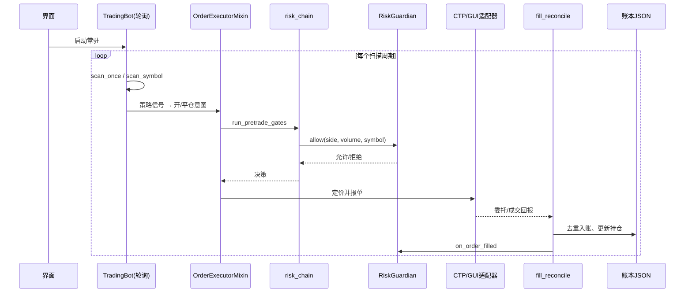
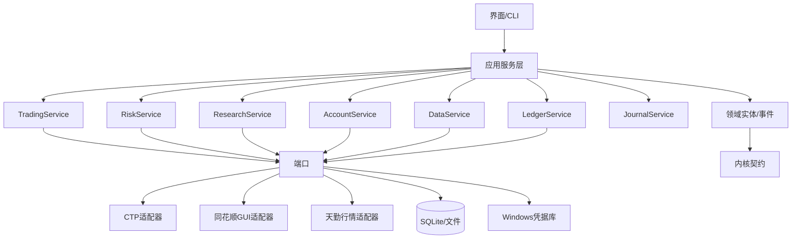
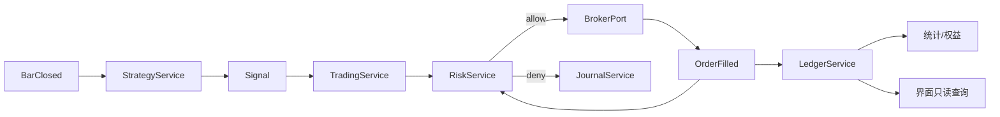
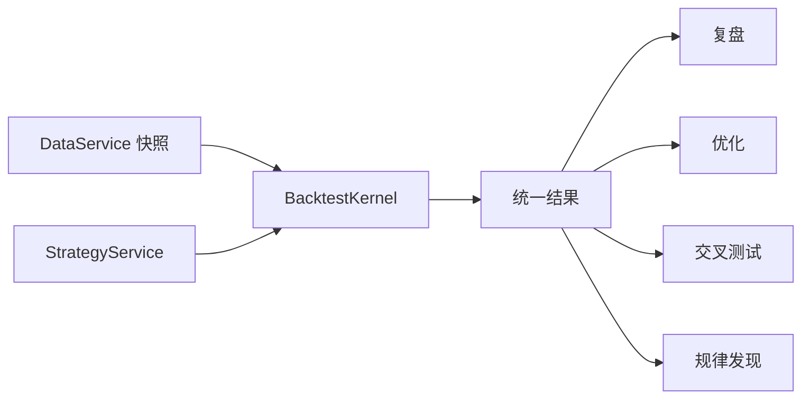

# 自动交易系统架构与演进方案

基线版本：**49.18.2**（2026-11-20）
用途：把现有系统讲清楚，并给出下一步“架构加固、方便日常维护”的落地顺序。
原则：**不推倒重写**，按“绞杀者模式”逐块替换；每一步都能单独上线、单独回退。

---

## 0. 结论速览

| 主题 | 现状（代码事实） | 目标 | 优先级 |
|---|---|---|---|
| 调度 | 单进程轮询：`while` 循环里 `schedule.run_pending()` + `scan_once()` | 进程内“命令总线 + 事件总线”，关键路径同步、旁路异步 | P2 |
| 事件总线 | `EventBus` 只在 UI 创建，用于回测/交叉测试进度；实盘链路没用 | 实盘也用同一套类型化事件，但保留确定性顺序 | P2 |
| 交易账号 | `account` 单块 + `ctp_profiles` 固定两份（`huatai_sim`/`huatai_live`），界面只能改不能增删 | 账号注册表 + 密钥库 + CRUD + 校验 + 审计 | **P0** |
| 风控 | `TradingBot` 持有 `RiskService`；纯规则、独立状态端口、JSONL/SQLite 决策留痕已接入 | 保持同步闸门，后续再扩展组合风控 | **P1 已完成** |
| 数据 | 行情继续用专用 SQLite；账本 JSON 为主，`data/trading.db` 同步保存交易与风控投影 | 保持单一统计口径，后续补合约版本快照 | **P1 双写完成** |
| 账本 | 四本固定账（GUI 实盘/模拟、CTP 仿真/真实），按渠道写死文件名 | 一账号一本账；渠道只是账号属性 | P1 |
| 策略 | `REGISTRY` 字典 + 别名 + 中文名；新增策略要改代码 | 插件清单 + 自动发现 + 参数 schema | P3 |
| 研究 | 回测/交叉/优化/复盘各有编排，共用策略接口与 K 线 | 统一 `BacktestKernel`，统一结果与运行清单 | P3 |
| 日志 | loguru + `data/events.jsonl`（20MB 轮转） | 结构化日志 + trace_id + 审计流水 + 告警 | P4 |

一句话：**现阶段最该先做的是账号注册表和密钥托管，其次是风控独立和账本/交易数据统一；事件总线和策略插件化放在后面，不要先动。**

---

## 1. 现状架构（以代码为准）

### 1.1 运行形态

- 单进程，多线程：
  - 主线程：CustomTkinter 界面。
  - `BotWorker`：常驻交易线程。
  - CTP 回调线程：成交/委托回报。
  - tick 录制线程（启用时）。
- 启动入口：`app_entry.py` → `src/main.py`；带 `--gui` 进界面，否则 `TradingBot.run_forever()`。
- 主循环：`src/scheduler/runner.py` 的 `while self._running: schedule.run_pending(); scan_once()`，扫描间隔来自 `schedule.scan_interval_sec`。
- 结论：**不是事件总线驱动，是轮询驱动**。事件总线目前只是 UI 的进度通知。

### 1.2 分层与依赖

| 层 | 目录 | 职责 |
|---|---|---|
| 界面 | `src/ui` | 页面、按钮、只读展示、命令下发 |
| 调度 | `src/scheduler` | 常驻循环、登录、扫描、下单编排、对账、清仓 |
| 业务 | `src/strategy`、`src/backtest`、`src/review`、`src/risk`、`src/account`、`src/data`、`src/trader`、`src/screen`、`src/research`、`src/ops`、`src/export` | 策略、研究、风控、账本、数据、柜台适配 |
| 领域/内核 | `src/domain`、`src/kernel` | 实体、账本定义、事件类型、风控闸门契约 |
| 基础设施 | `src/utils`、`src/login` | 配置、日志、密钥注入、登录辅助 |

`pyproject.toml` 的 import-linter 有三条硬约束：

1. `src.domain` / `src.kernel` 不得依赖任何业务、调度、界面模块。
2. 业务层不得依赖 `src.scheduler` / `src.ui`。
3. `src.scheduler` 不得依赖 `src.ui`。

这三条是现有架构最值钱的部分，后续改造要继续保持。

### 1.3 实盘调用链（现状）



关键点：

- 策略、风控、执行、账本都在**同一个调度线程**里串行完成；CTP 回调只把回报送进对账。
- `RiskService` 组合 `RiskGuardian`；`last_order_ts`、`open_orders_today`、日亏与 `halted` 同步保存到专用 JSON 和 SQLite，重启可恢复，旧 `bot_state` 仍是升级回退依据。
- 账本 JSON 文件（`data/signal_account*.json`）仍是权威来源；订单、成交、持仓与权益同步投影到 `data/trading.db`，四本 legacy 账及 CTP 柜台权益口径保持不变。

### 1.4 事件总线现状

- `src/kernel/events.py` 定义了 `ORDER_REQUEST`、`RISK_BLOCK` 等类型，但全仓库**没有发布/订阅使用**。
- `EventBus` 只在 `src/ui/app.py` 创建，用于回测、交叉测试的进度事件。
- 结论：实盘链路是“直接方法调用 + 轮询”，不是事件驱动。这个事实决定了改造顺序：**先把账号、风控、账本边界切干净，再谈事件化**。

### 1.5 数据与账本清单

| 数据 | 位置 | 格式 | 说明 |
|---|---|---|---|
| 主配置 | `config/config.yaml` | YAML | 运行配置；品种由表回写 |
| 密钥 | `config/secrets.local.yaml` | YAML 明文 | CTP 密码/认证码、天勤账号等 |
| 品种与合约 | `config/品种与合约.xlsx` | Excel | **唯一权威表**：乘数、每跳、保证金、手续费、时段、清仓 |
| 分钟 K 线 | `data/klines/market.sqlite` | SQLite（WAL） | `bars(symbol, period, ts, OHLC, volume, oi)` + `ingest_log` |
| 原始 K 线 | `data/klines/raw.sqlite` | SQLite | 清洗前的原始数据 |
| Tick | `data/ticks/vnpy_data.db` | SQLite（vnpy 表结构） | 走 vnpy `save_tick_data()`，不裸写 SQL |
| 账本 | `data/signal_account*.json` | JSON | 权威账本：`initial_capital`、`cashflows`、`trades`、`changes` |
| 交易投影 | `data/trading.db` | SQLite（WAL） | 订单、成交、持仓、权益、风控状态与决策；可删除重建 |
| 风控状态/决策 | `data/risk_state_*.json`、`data/risk_decisions.jsonl` | JSON/JSONL | JSON 优先恢复与查询回退，SQLite 同步副本 |
| 账期存档 | `data/signal_periods*` | JSON | 按账本分目录 |
| 运行状态 | `data/bot_state*.json` | JSON | 持仓、信号标记等 |
| 委托意图 | `data/order_intent*.json` | JSON | 崩溃恢复用 |
| 当前账本 | `data/active_account.json` | JSON | 只记“选中哪本” |
| 上线进度 | `data/go_live.json` | JSON | 四阶段完成情况 |
| 事件流水 | `data/events.jsonl` | JSONL | `ts`、`run_id`、`event`、附加字段；20MB 轮转 |
| 日志 | `logs/` | 文本 | loguru 输出 |

结论：**行情与交易都已有 SQLite；交易侧当前采用 JSON 权威 + SQLite 同步投影，账号注册表仍以 YAML 为主，尚未把所有运行时数据强行迁入单一数据库。**

### 1.6 交易账号现状

- 配置里只有一块 `account`（券商、通道、资金号、密码变量、验证码模式）。
- `trade.ctp.ctp_profiles` 固定两个槽：`huatai_sim`、`huatai_live`；界面能编辑字段，但**不能新增、复制、停用、删除**。
- 密码/认证码在 `secrets.local.yaml` 明文，或由环境变量注入。
- `BrokerProfile` 字段（`src/trader/ctp_profile.py`）：
  `name`、`label`、`kind`、`broker_id`、`td_front`、`md_front`、`user_id`、`password_env`、`app_id`、`auth_code_env`、`flow_dir`、`close_split_products`、`price_tick`、`max_order_volume`、`order_wait_sec`、`query_interval_sec`、`login_timeout_sec`、`order_count_warn`、`cancel_count_warn`、`auto_cancel_on_timeout`、`cancel_wait_sec`。
- 交易前置是有的：`td_front`（交易前置）、`md_front`（行情前置），支持逗号分隔多前置。
- 问题不在“字段不够”，而在**账号没有身份、没有生命周期、没有多账号并存、没有密钥托管**。

### 1.7 策略管理现状

- `src/strategy/factory.py` 用 `REGISTRY: dict[str, StrategyFactory]` 注册；别名、中文名、审计模式、参数默认值都集中在同一个文件。
- `rule_dsl` 是唯一“不写代码加策略”的入口：加载 `rules/*.yaml`。
- 新增一个 Python 策略，至少要改：策略文件、`REGISTRY`、`ENGINE_LABELS`、部分参数映射；UI 下拉从工厂派生，通常不用再改。
- 没有插件清单、版本号、参数 schema、自动发现。

### 1.8 研究环境现状

- 历史回测：`src/backtest/engine.py`，输入 bars + 成交模型 + 流动性模型，输出交易明细与统计。
- 交叉测试、策略优化：各自编排，复用策略接口和 K 线存储。
- 复盘：`src/review/replay.py` 有独立重放编排，策略计算与回测共用策略接口。
- 规律发现：`src/screen` 独立扫描。
- 问题：**结果结构、运行清单、样本外口径没有完全统一**，同一策略在不同页可能得到不同口径的数字。

### 1.9 现有架构约束（事实）

1. 账号是固定槽位，不是注册表；真实/仿真靠约定，不靠数据约束。
2. `RiskService` 已由调度器组合使用，独立状态和决策留痕已落地；调度仍负责调用同步风控端口。
3. 账本按渠道写死四本，账号与账本不是一对一关系。
4. 交易与风控已有 SQLite 投影，但 JSON/YAML 仍是相应权威来源；跨表查询已可用，完整迁移不在本阶段范围内。
5. 实盘链路是轮询 + 直接调用，`ORDER_REQUEST`/`RISK_BLOCK` 事件定义了但没用。
6. 策略注册要改代码；没有插件清单和参数 schema。

---

## 2. 目标架构

### 2.1 设计原则

1. **关键路径同步、旁路异步**：风控和报单必须确定性顺序，不能为了“事件化”把顺序交给线程池。
2. **领域不依赖基础设施**：CTP、GUI、SQLite、Excel 都是适配器，可替换。
3. **一个账号一本账**：渠道（sim/gui/ctp）是账号属性，不再是账本身份。
4. **风控独立**：执行器只负责“怎么发”，风控负责“能不能发”。
5. **数据分层**：交易元数据进 SQLite；行情时序用专用存储；日志只追加。
6. **可回放**：任何一笔交易都能追到信号、参数、数据版本、风控决策。

### 2.2 目标分层



目标目录（渐进迁移，不要求一次搬完）：

```
src/
  domain/          # 实体、值对象、事件、账本定义
  kernel/          # 端口协议、命令/事件总线、错误码
  application/
    account/       # 账号注册表、档案、密钥引用、生命周期
    trading/       # 交易编排、订单路由
    risk/          # 交易前/持仓中/组合风控
    strategy/      # 插件注册、参数 schema、生命周期
    research/      # 回测内核、交叉、优化、复盘、规律
    ledger/        # 订单/成交/持仓/权益/统计
    journal/       # 日志、审计、告警
  infrastructure/
    brokers/ctp/   # CTP 适配器
    brokers/gui/   # 同花顺点击适配器
    data/tq/       # 天勤行情
    storage/       # SQLite、文件、Parquet
    secrets/       # Windows DPAPI/凭据库
    config/        # YAML、Excel 导入
  interfaces/
    ui/            # CustomTkinter
    cli/           # 命令行
```

### 2.3 进程内命令总线 + 事件总线

不建议引入 Kafka/RabbitMQ：单机单账户，收益低、运维重。建议进程内类型化总线：

- **命令**（有明确接收者、可拒绝）：`StartEngine`、`PauseEntries`、`FlattenSymbol`、`SubmitManualOrder`、`ClaimPosition`、`ReloadConfig`。
- **事件**（已发生的事实、可多订阅）：`BarClosed`、`SignalGenerated`、`OrderIntentCreated`、`RiskDecided`、`OrderSubmitted`、`OrderFilled`、`PositionChanged`、`AccountSynced`、`FlattenDue`、`AlertRaised`。
- **投递语义**：
  - 风控与报单在同一个调度线程内同步完成，保证顺序。
  - 账本、日志、UI 通知可以异步订阅，但不能改变交易结果。
  - 订单/成交事件先写“发件箱”（SQLite 同事务），再发内存事件；崩溃后可从发件箱补发，避免“报了单没记账”。
- **幂等键**：`order_id`、`fill_id`、`(account_id, symbol, bar_ts, action)`。

### 2.4 模块职责与勾稽关系

| 模块 | 负责 | 输入 | 输出 | 不负责 |
|---|---|---|---|---|
| AccountService | 账号档案、密钥引用、启停、校验 | 账号 CRUD、柜台测试 | `TradingAccount` DTO | 下单、账本统计 |
| TradingService | 交易编排、通道选择、订单路由 | 信号、账号 DTO、风控决策 | 订单命令、成交事件 | 风控规则、账本计算 |
| RiskService | 交易前/持仓中/组合风控 | 订单意图、持仓、权益、规则 | `RiskDecision` | 发单、改策略 |
| StrategyService | 策略注册、参数校验、生命周期 | 配置、行情、持仓 | `Signal` | 下单、风控 |
| ResearchService | 回测/交叉/优化/复盘/规律 | 数据快照、策略、参数 | 结果、运行清单 | 实盘状态 |
| DataService | 数据源、入库、目录、质量 | 下载任务、实时 tick | bars/ticks、数据目录 | 策略计算 |
| LedgerService | 订单/成交/持仓/权益/统计 | 成交事件、资金流水 | 账本、统计、权益曲线 | 发单、风控 |
| JournalService | 日志、审计、告警 | 所有事件 | 日志、审计表、通知 | 业务判断 |

数据流（实盘）：



数据流（研究）：



### 2.5 交易账号管理（重点补齐）

现状的问题是“账号只是配置里的一个槽”，成熟系统应改成“注册表 + 档案 + 密钥引用 + 账本绑定”。

#### 2.5.1 数据模型

```yaml
# 账号注册表（建议存 SQLite 的 accounts 表；YAML 仅作导入导出）
accounts:
  - account_id: acc_huatai_sim_01        # 稳定 ID，不随显示名变
    display_name: 华泰仿真-主账号
    broker: huatai
    channel: ctp                         # ctp / gui / sim
    environment: sim                     # sim / live
    status: enabled                      # enabled / disabled / archived
    profile_id: prof_huatai_sim          # 连接模板
    investor_id: "28077"
    book_id: book_acc_huatai_sim_01      # 一本账，一对一
    risk_policy_id: default              # 绑定的风控策略
    max_order_volume: 5
    notes: ""
    created_at: "..."
    updated_at: "..."

# 连接模板（同一券商的多账号共用）
broker_profiles:
  - profile_id: prof_huatai_sim
    broker: huatai
    broker_id: "..."                     # 期货公司 BrokerID
    td_front: "tcp://...:..."            # 交易前置，可多地址
    md_front: "tcp://...:..."            # 行情前置
    app_id: "..."
    auth_code_ref: secret://ctp/auth_code
    password_ref: secret://ctp/huatai_sim/password
    query_interval_sec: 30
    login_timeout_sec: 20
    order_wait_sec: 8
    cancel_wait_sec: 3
    order_count_warn: 8
    cancel_count_warn: 8
    close_split_products: ["bu", "c"]
```

要点：

- `account_id` 用稳定 ID（UUID 或 `broker_env_seq`），显示名可改，账本和审计引用 ID。
- `environment` 是硬约束：`live` 账号不得使用仿真前置；`sim` 账号不得填真实资金号（保存时校验）。
- `password_ref` / `auth_code_ref` 只是引用，不存明文。
- `book_id` 一对一；渠道只是属性，不再决定账本文件名。
- `risk_policy_id` 让“同一个策略、不同账号”可以有不同风控。

#### 2.5.2 密钥托管

现状：`secrets.local.yaml` 明文。目标：

1. 首选 **Windows 凭据管理器/DPAPI**（`keyring` 库），只存引用。
2. 兼容环境变量（CI/临时）。
3. 导出/备份时只导出引用，不导出密钥。
4. 启动时由 `SecretPort.resolve(ref)` 注入到 CTP 适配器，**不写回 config.yaml**。
5. 审计：谁在什么时候读取了哪个密钥（只记引用，不记值）。

#### 2.5.3 账号页 CRUD

- 列表：显示名、券商、环境、状态、账本、上次测试结果。
- 新建：选券商模板 → 填资金号/前置/密钥 → 测试连通 → 保存。
- 编辑：资金号、前置、上限、告警阈值；`environment` 变更需二次确认。
- 复制：以现有账号为模板新建（仿真复制到真实时强制改资金号和前置）。
- 停用：不再允许新开仓；可平仓、可查账。
- 归档：只读，不能下单；账本保留。
- 删除：仅允许无持仓、无未完成委托、非当前账本时；默认软删除。
- 实盘保护：切到 `environment=live` 需要输入账号后四位确认，并写审计。

#### 2.5.4 迁移方案

1. 把现有 `huatai_sim` / `huatai_live` 两个档案导入为两条 `broker_profiles`。
2. 把 `account` 与两份档案里的资金号导入为两条 `accounts`，`book_id` 对应现有四本账中的 CTP 两本。
3. `config_loader` 先读新注册表；读不到时回退旧字段，保证旧配置能启动。
4. 双读一段时间，日志对比“旧解析结果 vs 新解析结果”，一致后再删旧路径。
5. 现有 `secrets.local.yaml` 一次性迁移到凭据库，保留只读备份。

### 2.6 风控是否应该独立

**应该独立，而且优先级高于事件总线。**

理由：

1. 现在 `RiskGuardian` 由 `TradingBot` 创建、状态在内存；换通道、加账号、做回放都受调度器生命周期影响。
2. 风控规则需要单测和回放：同一组订单意图 + 持仓 + 权益，应该得到同一个决策。
3. 多账号后，“每个账号一套日亏/仓位/频率限制”必须能独立配置。
4. 审计要求：每次拒绝都要能落到“哪条规则、什么输入、什么阈值”。

目标拆成三层：

- `PreTradeRisk`：手数、最小间隔、日开仓次数、日亏损、上线阶段、可用资金、保证金、价格偏离。
- `PositionRisk`：止损、移动止损、时间止损、减仓。
- `PortfolioRisk`：单品种集中度、总保证金占用、相关性/净敞口（后续）。

实现要点：

- 规则是纯函数：`decide(intent, snapshot, policy) -> RiskDecision`。
- `RiskStateStore` 持久化：`last_order_ts`、`open_orders_today`、`day_pnl`、`halted`、`halt_reason`。
- 执行器只消费 `RiskDecision`，不再自己判断“能不能发”。
- 决策写审计表：`risk_decisions(ts, account_id, symbol, action, volume, allow, rule, message, snapshot_json)`。

### 2.7 数据架构（回应“是否统一分表”）

**建议混合，不建议把所有东西塞进一个库。**

| 数据类型 | 存储 | 原因 |
|---|---|---|
| 账号、档案、账本、订单、成交、持仓快照、权益、风控决策、配置版本、数据目录、上线进度 | `data/trading.db`（SQLite，WAL） | 事务、关联查询、审计、单机足够 |
| 分钟 K 线 | 保留 `data/klines/market.sqlite` | 已成熟，点查快；研究可导出 Parquet |
| Tick | 保留 `data/ticks/vnpy_data.db` 或改 Parquet 分区 | 数据量大，SQLite 单写者不适合高吞吐；vnpy 兼容优先 |
| 日志/事件 | `data/events.jsonl` + `logs/` | 只追加，便于排查；不进业务库 |
| 品种与合约 | Excel 主数据 → `instruments` 表快照 | 人可编辑，程序读快照，避免运行时解析 Excel |

`trading.db` 建议表：

```sql
accounts(account_id PK, display_name, broker, channel, environment, status,
         profile_id, investor_id, book_id, risk_policy_id, max_order_volume,
         created_at, updated_at)
broker_profiles(profile_id PK, broker, broker_id, td_front, md_front, app_id,
                auth_code_ref, password_ref, query_interval_sec, login_timeout_sec,
                order_wait_sec, cancel_wait_sec, order_count_warn, cancel_count_warn)
books(book_id PK, account_id, currency, initial_capital, started_at, status)
orders(order_id PK, account_id, symbol, action, volume, price, status,
       client_id, broker_order_id, created_at, submitted_at, finished_at,
       reject_reason, raw_json)
fills(fill_id PK, order_id, account_id, symbol, action, volume, price,
      fee, slippage_ticks, filled_at, trade_id, raw_json)
positions(account_id, symbol, side, volume, avg_price, stop_price,
          updated_at, PRIMARY KEY(account_id, symbol, side))
equity_snapshots(account_id, ts, equity, available, margin, day_pnl,
                 PRIMARY KEY(account_id, ts))
cashflows(id PK, account_id, ts, kind, amount, note)
signals(id PK, account_id, strategy_id, symbol, bar_ts, action, price,
        score, reason, created_at)
risk_decisions(id PK, ts, account_id, symbol, action, volume, allow,
               rule, message, snapshot_json)
config_versions(id PK, ts, version, source, hash, diff_json)
instruments(symbol PK, product, multiplier, tick, margin_rate, fee_open,
            fee_close, fee_close_today, sessions, flatten_time, effective_from)
data_catalog(id PK, dataset, symbol, period, start_ts, end_ts, rows,
             source, updated_at)
go_live_state(stage PK, completed_at, evidence_json)
```

原则：

- 订单/成交/风控决策**只追加**，不 UPDATE 历史；状态用最新快照表。
- 账本统计从 `fills` + `equity_snapshots` 派生，不手写第二套。
- 大字段（原始回报 JSON）可放 `raw_json` 或单独文件，避免拖慢主表。
- 跨库关联用 `account_id` / `symbol` / `ts`，不建跨库外键。

### 2.8 本地账户与统计

- 一本账 = 一个 `account_id`；GUI 实盘、GUI 模拟、CTP 仿真、CTP 真实只是四个初始账号。
- 订单和成交先入 `orders`/`fills`，持仓和权益由 `LedgerService` 派生。
- 统计只保留一套实现：胜率、盈亏比/盈利因子、最大回撤、资金利用率、净盈亏。
- 账户分析页、复盘页、导出全部调用同一个 `StatsService`，避免三处口径不同。
- 历史 JSON 账本做一次性导入，导入后只读；新数据不再写 JSON。

### 2.9 策略插件化

目标：新增策略只加一个目录，不改工厂。

插件清单示例：

```yaml
id: multi_factor
name: 多因子CTA
version: 2.1.0
entrypoint: strategies.multi_factor:MultiFactorStrategy
timeframes: ["5m", "15m", "30m", "1h"]
warmup_bars: 120
params_schema:
  atr_stop_mult: {type: float, default: 2.0, min: 0.5, max: 6}
  score_threshold: {type: float, default: 0.3, min: 0, max: 1}
data_requirements: [bars]
state_schema_version: 1
```

- 注册：装饰器 + 包扫描；`rule_dsl` 也作为一个插件。
- 注册表支持启用/停用/版本查询；删除只允许“无持仓、无运行中回测引用”时软删除，历史结果仍能按版本复现。
- 参数：UI 按 schema 自动生成控件，保存前校验。
- 版本：配置里记录 `strategy_id + version + params_hash`；回测结果记录代码 hash + 数据快照，保证可复现。
- 生命周期：加载 → 校验 → 预热 → 评估；缺数据或参数非法时拒绝启动，不静默回退。

### 2.10 研究环境统一

- 一个 `BacktestKernel`：输入 `MarketDataSlice + Strategy + ExecutionModel + RiskModel`，输出统一 `BacktestResult`。
- 历史回测、交叉测试、优化、复盘、规律发现都调用它，只换数据切片和编排。
- 复盘 = 当日数据切片 + 实盘账本对照，不再单独实现一套策略计算。
- 统一运行清单：`run_id`、数据版本、策略版本、参数、成交模型、滑点、费用、代码 commit。
- 统一结果：交易明细、权益曲线、统计、拒单原因、成交约束说明。

### 2.11 日志与可观测性

- 结构化日志字段：`ts`、`level`、`trace_id`、`account_id`、`strategy_id`、`symbol`、`order_id`、`event`、`message`、`extra`。
- 三类输出分开：
  - 运行日志：`logs/app-YYYYMMDD.log`，按天/大小轮转。
  - 审计流水：SQLite `audit_log`，只追加，记录下单、撤单、风控拒绝、账号变更、配置变更。
  - 事件流水：`data/events.jsonl`，给界面时间线和排障。
- 信号单独留痕：`signals` 表记策略、品种、K 线时间、动作、价格、分数、理由；日志里保留同一 `trace_id`，能从信号追到订单和成交。
- 关键指标：扫描耗时、报单确认延时、成交延时、拒单率、滑点、冻结次数、对账差异。
- 告警：断线、冻结、日亏触顶、连续拒单、数据缺失、账号测试失败。

### 2.12 接口契约（建议）

```python
@dataclass(frozen=True)
class Signal:
    account_id: str
    strategy_id: str
    symbol: str
    bar_ts: str
    action: str          # buy_open / sell_open / close
    price: float
    score: float
    reason: str

@dataclass(frozen=True)
class OrderIntent:
    account_id: str
    symbol: str
    action: str
    volume: int
    price: float | None
    stop_price: float | None
    source: str          # strategy / manual / flatten
    signal_id: str | None

@dataclass(frozen=True)
class RiskDecision:
    allow: bool
    rule: str
    message: str
    adjusted_volume: int | None
```

端口：

- `BrokerPort`：`submit(intent) -> order_id`、`cancel(order_id)`、`query_positions()`、`query_account()`。
- `MarketDataPort`：`get_bars(symbol, period, start, end)`、`subscribe_ticks(symbols)`。
- `SecretPort`：`resolve(ref) -> str`。
- `LedgerPort`：`record_fill(fill)`、`snapshot_position(...)`、`equity(account_id)`。
- `ClockPort`：统一交易日、时段、清仓时刻。
- `NotifierPort`：告警。

### 2.13 模块勾稽矩阵

| 数据 | 生产 | 消费 |
|---|---|---|
| 账号 DTO | AccountService | TradingService、RiskService、UI |
| 合约/费率 | DataService（表快照） | 策略、回测、风控、账本统计 |
| K 线/tick | DataService | 策略、研究、复盘 |
| 信号 | StrategyService | TradingService、Journal |
| 订单意图 | TradingService | RiskService |
| 风控决策 | RiskService | TradingService、审计 |
| 订单/成交 | BrokerPort → LedgerService | 风控、统计、UI、复盘 |
| 持仓/权益 | LedgerService | 风控、策略、UI |
| 统计 | StatsService | 账户分析、复盘、导出 |

---

## 3. 演进路线（每步可独立上线/回退）

### P0：账号注册表 + 密钥托管（先做）

- [x] 新增 `config/accounts.yaml` 注册表（`src/account/registry.py`）；首次 `load_config()` 自动从旧 `ctp_profiles` 迁移，`huatai_sim`/`huatai_live` 与 GUI 号落成三条账号。
- [x] 账号页支持新增、编辑、复制、停用、归档、软删除；保存前校验环境/前置/资金号（`src/domain/trading_account.py`）。
- [x] 密钥迁移到 Windows DPAPI（`config/secrets.dpapi.json`，`src/utils/secret_store.py`）；`secrets.local.yaml` 只读备份。
- [x] `config_loader` 双读：新注册表优先，旧字段回退；`trade.ctp.account_registry: false` 可整体关闭。
- 验收：新增一个仿真账号不改代码即可登录；真实账号误填仿真前置会被拦住；密钥不出现在 `config.yaml`。
- 回退：删 `config/accounts.yaml` 与 `config/secrets.dpapi.json`，或把 `trade.ctp.account_registry` 设为 `false`，继续读旧 `ctp_profiles`。
- 详细规格与验证记录：`docs/spec/p0-account-registry/`。

### P1：账本/交易数据统一 + 风控独立（双写阶段已完成）

- [x] 建 `data/trading.db`；订单、成交、持仓、权益、风控状态与决策同步双写（JSON/JSONL + SQLite），采用 WAL 和短连接。
- [x] JSON 仍是权威账本；SQLite 保存无损账本快照及规范化投影，失败只记日志，不回滚 JSON，也不改变交易决定。
- [x] 账户分析/复盘/导出继续共用现有 FIFO 与统计实现；SQLite 读回快照后调用同一套盈亏函数，不另写一套 PnL 算法。
- [x] 抽出 `RiskService`，`Guardian` 规则改为纯函数 + `RiskStateStore`；旧 `bot_state` 仍可回退恢复，回测继续使用 `RiskGuardian`。
- [x] 验收：同一交易日，JSON 与 SQLite 的成交笔数、净盈亏一致；重启后日开仓次数、日亏、最近下单时间不丢；风控决策可按账号和交易日查询。
- 回退：`storage.sqlite_enabled: false` 关闭 SQLite，仍以 JSON/JSONL 为准，不创建 `data/trading.db`。
- 本阶段保留四本 legacy live/paper/CTP 账及 CTP 柜台权益语义；“账号注册表与账本完全一对一”的界面/配置迁移不属于本次双写改造。

### P2：实盘事件化 + 发件箱

- 引入进程内命令/事件总线；关键路径同步，账本/日志/UI 异步。
- 订单/成交事件先写发件箱，再发内存事件；崩溃可补发。
- 验收：断线重启后未完成委托能恢复；同一成交不会重复入账；事件顺序可回放。
- 回退：总线开关关闭，回到直接调用。

### P3：数据目录 + 策略插件

- 合约表导入 `instruments` 快照；K 线/tick 建目录表；研究统一走快照。
- 策略插件清单 + 参数 schema + 自动发现；UI 自动列策略。
- 验收：新增策略只加目录；回测结果能追到策略版本和数据版本。
- 回退：插件加载失败时回退到 `REGISTRY`。

### P4：研究内核统一 + 可观测性

- 历史/交叉/优化/复盘/规律统一 `BacktestKernel` 和结果结构。
- 结构化日志、trace_id、审计表、关键指标、告警。
- 验收：同一策略同一数据，各页净盈亏和交易笔数一致；一笔单能从信号追到成交和风控决策。

---

## 4. 对你几个问题的直接回答

**1）交易账号档案应包含什么？**
账号身份（`account_id`、显示名）、券商、通道、环境（仿真/真实）、状态、资金号、连接模板、交易前置、行情前置、BrokerID、AppID、认证码引用、密码引用、查询间隔、登录超时、报单超时、撤单等待、单笔最大手数、报撤单告警阈值、分平今品种、账本 ID、风控策略 ID、创建/更新时间。

**2）交易前置怎么封装？**
放在 `broker_profiles`，不放在账号里重复；账号只引用 `profile_id`。同一券商多账号共用前置，换前置只改一处。前置支持多地址，按顺序尝试。

**3）风控该不该独立？**
该。此前 `RiskGuardian` 绑在调度器上、状态只在内存；现在 `RiskService` 已提供纯规则、按账号状态恢复和决策审计，执行器仍只负责发单，同步风控顺序不变。

**4）数据库要不要统一分表？**
要统一“交易元数据”，但不要把行情 tick 塞进同一个库。建议 `trading.db`（账号/订单/成交/持仓/权益/风控/目录/上线）+ 现有 `market.sqlite`（K 线）+ tick 专用库/Parquet + JSONL 日志。

**5）事件总线现在是不是核心？**
不是。现在核心是轮询；`EventBus` 只服务 UI 进度。建议先把账号、风控、账本边界切好，再用进程内总线替换轮询编排，不要先上外部消息队列。

**6）模块之间怎么勾稽？**
账号 → 交易 → 风控 → 柜台 → 成交 → 账本 → 统计 → 界面；研究侧从数据快照和策略插件出发，走统一回测内核，结果回给复盘/优化/交叉测试。

---

## 5. 不建议现在做的事

1. 不要把所有数据（尤其 tick）塞进一个 SQLite：单写者、锁竞争、研究扫描会拖慢实盘。
2. 不要先上 Kafka/RabbitMQ/微服务：单机单账户，复杂度远大于收益。
3. 不要为了“事件驱动”把风控和报单丢进线程池：顺序和幂等会失控。
4. 不要一次性重写全部目录：按 P0→P4 绞杀式替换，每步保留回退。
5. 不要在账号体系没做好前接第二个期货公司：会把固定槽位问题放大。
